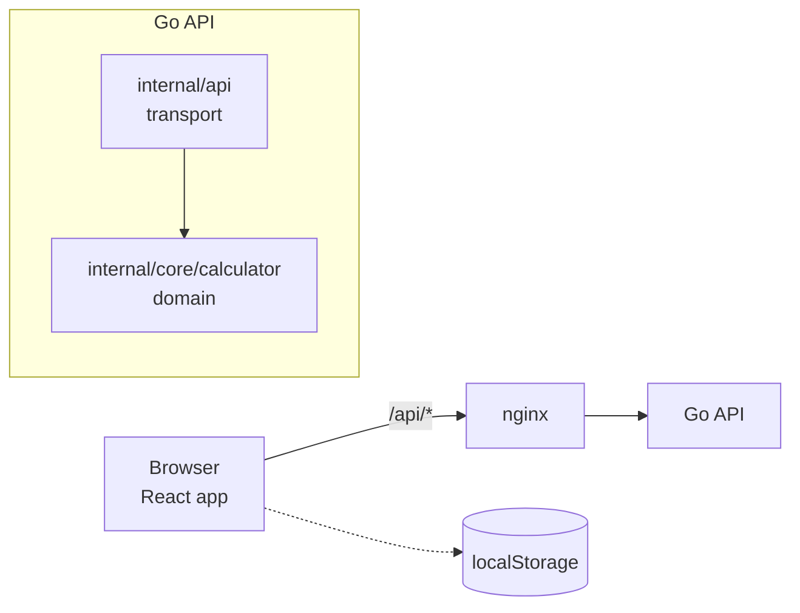

# Calculator: React frontend + Go microservice

A web calculator whose arithmetic is done by a Go REST service. The React frontend handles
input and display, and keeps your current calculation and history across sessions.

- **Operations:** add, subtract, multiply, divide, power, square root and percentage.
- **Usable with mouse, touch or keyboard;** responsive from 320 px wide; light and dark themes
  that follow the operating system.
- **Robust input handling** on both sides, with clear messages for errors such as division by
  zero or an unreachable service.
- **Tested:** 92.9% statement coverage on the backend, 100% on the frontend
  ([coverage report](docs/coverage.md)).

<!-- TOC -->
- [Quick start with Docker](#quick-start-with-docker)
- [Running locally](#running-locally)
- [Tests and coverage](#tests-and-coverage)
- [API](#api)
- [How the calculator behaves](#how-the-calculator-behaves)
- [Architecture](#architecture)
- [Design decisions](#design-decisions)
- [Assumptions](#assumptions)
- [Project structure](#project-structure)
- [What I would do next](#what-i-would-do-next)
- [How this was built](#how-this-was-built)

## Quick start with Docker

Requires Docker with Compose v2.

```bash
docker compose up --build
```

Open <http://localhost:3000>. nginx serves the app and forwards `/api/*` and `/healthz` to
the Go service, which is not exposed directly. Stop it with `docker compose down`.

## Running locally

Requires **Go 1.27+** and **Node.js 22+**.

**Backend** (listens on <http://localhost:8080>):

```bash
cd backend
go run ./cmd/api
```

| Variable | Default | Purpose |
|----------|---------|---------|
| `PORT` | `8080` | Listening port |
| `ALLOWED_ORIGINS` | empty | Comma-separated CORS origins. Not needed with the dev proxy or Docker |
| `LOG_LEVEL` | `info` | `debug`, `info`, `warn` or `error`. Logs are JSON on stdout |

**Frontend** (in a second terminal, on <http://localhost:5173>):

```bash
cd frontend
npm ci
npm run dev
```

The Vite dev server proxies `/api` to `http://localhost:8080`, so the browser talks to a single
origin, as it does behind nginx. Set `API_PROXY_TARGET` to point it somewhere else. For a build
served from a different origin than the API, set `VITE_API_BASE_URL` at build time and add that
origin to the backend's `ALLOWED_ORIGINS`.

## Tests and coverage

```bash
# Backend: format, vet, tests with coverage
cd backend
gofmt -l .
go vet ./...
go test ./... -coverprofile=coverage.out
go tool cover -func=coverage.out

# Frontend: lint, type check, tests with coverage, production build
cd frontend
npm run lint
npm run typecheck
npm run coverage        # HTML report in frontend/coverage/index.html
npm run build
```

CI ([.github/workflows/ci.yml](.github/workflows/ci.yml)) runs all of the above on every push
and pull request, runs the Go tests with the race detector, uploads both coverage reports, and
finishes with a smoke test of the Docker stack.

> **Windows notes.** `go test -race` needs cgo and a C compiler, so it runs in CI only. Run the
> frontend tests from PowerShell or cmd: in Git Bash, Vitest fails to load its setup file
> ("failed to find the current suite").

## API

Base path `/api/v1`. The full contract is in [api/openapi.yaml](api/openapi.yaml).

| Method | Path | Description |
|--------|------|-------------|
| `POST` | `/api/v1/calculate` | Perform one operation |
| `GET` | `/api/v1/operations` | List supported operations, their symbols and operand counts |
| `GET` | `/healthz` | Liveness check |

### Request and response

```json
POST /api/v1/calculate
{ "operation": "divide", "operands": [10, 4] }

200 OK
{ "operation": "divide", "operands": [10, 4], "result": 2.5 }
```

| Operation | Operands | Result |
|-----------|----------|--------|
| `add`, `subtract`, `multiply`, `divide` | `[a, b]` | a + b, a − b, a × b, a ÷ b |
| `power` | `[base, exponent]` | base raised to exponent |
| `sqrt` | `[a]` | √a |
| `percent` | `[v]` or `[v, base]` | v ÷ 100, or base × v ÷ 100 |

Results are rounded to 12 significant digits, so `0.1 + 0.2` returns `0.3`.

### Errors

Every error has the same shape, and clients should branch on `code`, not on `message`:

```json
{ "error": { "code": "division_by_zero", "message": "division by zero" } }
```

| Status | Code | When |
|:------:|------|------|
| 400 | `invalid_request` | Malformed JSON, unknown fields, missing `operation` or `operands`, null or non-numeric operands, numbers beyond the float64 range |
| 413 | `payload_too_large` | Body over 1 MB |
| 422 | `unsupported_operation` | Unknown operation name |
| 422 | `invalid_operand_count` | Wrong number of operands for the operation |
| 422 | `division_by_zero` | `divide` by 0, or `power` of 0 with a negative exponent |
| 422 | `negative_square_root` | `sqrt` of a negative number |
| 422 | `undefined_result` | No real result, e.g. `power` of a negative base with a fractional exponent |
| 422 | `result_overflow` | Result beyond ±1.8e308 |
| 500 | `internal_error` | Unexpected failure; details are logged, not returned |

### Examples

Use `http://localhost:3000` with Docker or `http://localhost:8080` when running the backend
directly. In Windows PowerShell, call `curl.exe` instead of `curl`.

```bash
API=http://localhost:3000

curl -s -X POST $API/api/v1/calculate -H 'Content-Type: application/json' \
  -d '{"operation":"multiply","operands":[12,3]}'
# {"operation":"multiply","operands":[12,3],"result":36}

curl -s -X POST $API/api/v1/calculate -H 'Content-Type: application/json' \
  -d '{"operation":"percent","operands":[10,200]}'
# {"operation":"percent","operands":[10,200],"result":20}

curl -s -X POST $API/api/v1/calculate -H 'Content-Type: application/json' \
  -d '{"operation":"sqrt","operands":[-9]}'
# 422 {"error":{"code":"negative_square_root","message":"square root of a negative number"}}

curl -s -X POST $API/api/v1/calculate -H 'Content-Type: application/json' \
  -d '{"operation":"add","operands":[1,null]}'
# 400 {"error":{"code":"invalid_request","message":"operands.1 must be a number, got null"}}

curl -s $API/api/v1/operations
curl -s $API/healthz
```

## How the calculator behaves

It works like a phone calculator. The complete behaviour is specified as Given/When/Then
tables in the [functional spec](docs/specs/functional.md), and the reducer tests follow those
tables row by row.

- **Chaining** is left to right, without operator precedence: `2 + 3 × 4 =` gives `20`. Each
  completed step is one API call.
- **Percent depends on context:** `200 + 10%` adds 10% of 200 (giving 220), while `200 × 10%`
  multiplies by 0.1, and `50%` alone is 0.5.
- **History:** the last 50 calculations are listed. Click one to reuse its result. On narrow
  screens the history opens with a toggle.
- **Persistence:** the current entry, the pending operation and the history are saved to
  localStorage. Close the tab and you continue where you left off.
- **Keyboard:**

  | Key | Action |
  |-----|--------|
  | digits and `.` | type a number |
  | `+ - * / ^` | operators |
  | `Enter` or `=` | equals |
  | `Backspace` | delete the last digit |
  | `Escape` | clear (AC) |
  | `%` | percent |
  | `r` | square root |
  | `n` | change sign |

## Architecture



**Backend.** The domain-driven core (`internal/core/calculator`) holds every business rule: the
operations as value objects in a registry, operand and result validation, rounding, and the
domain errors. It imports only the standard library and knows nothing about HTTP. The API
layer (`internal/api`) decodes and validates requests, calls the core through an interface it
declares itself, and maps domain errors to status codes. `cmd/api` wires everything together.
There is no infrastructure layer because nothing external needs adapting: the service is
stateless.

**Frontend.** The calculator is a pure reducer (`state/calculatorReducer.ts`). Arithmetic
intents become a `pendingRequest` in state, which the `useCalculator` hook sends to the API
with an `AbortController`. Stale answers are ignored by request id. A reusable
`usePersistentReducer` hook saves state to versioned, validated localStorage. Components are
presentational, and the keypad is generated from one table of key definitions shared with the
keyboard map.

Details: [architecture spec](docs/specs/architecture.md).

## Design decisions

Each decision has a short Architecture Decision Record with its context, alternatives and
consequences.

| ADR | Decision | In short |
|-----|----------|----------|
| [0001](docs/adr/0001-spec-driven-development.md) | Spec-driven development | Specs, ADRs and the OpenAPI contract were written and reviewed before code |
| [0002](docs/adr/0002-layered-backend.md) | Core domain + API layer, no infrastructure layer | DDD boundaries without layers that would only forward calls |
| [0003](docs/adr/0003-keypad-interaction-and-single-endpoint.md) | Keypad UI, one `POST /calculate` endpoint | Small, fully testable domain; new operations need no new routes |
| [0004](docs/adr/0004-float64-with-rounding.md) | `float64` with 12-digit rounding | No dependencies; hides `0.1 + 0.2` artefacts. A decimal type would suit money |
| [0005](docs/adr/0005-standard-library-http.md) | Standard library `net/http` | Go 1.22+ routing is enough for three routes; zero dependencies |
| [0006](docs/adr/0006-client-side-state-and-persistence.md) | Client-side state, persistence and history | Resume across sessions without accounts or a database |
| [0007](docs/adr/0007-contextual-percentage.md) | Contextual percentage | Matches phone calculators: `200 + 10% = 220` |
| [0008](docs/adr/0008-docker-compose-with-nginx.md) | Compose with nginx in front of the API | Independent images, one origin, non-root containers |

## Assumptions

- Keypad semantics rather than expression parsing: operations apply left to right as entered.
- IEEE-754 doubles are precise enough for a general-purpose calculator. Results are exact to
  12 significant digits.
- An unknown operation name is a well-formed request the domain cannot fulfil, so it returns
  422 like other domain errors. Only a malformed body returns 400.
- History is per browser and capped at 50 entries. There are no user accounts.
- The API is internal to this app: no authentication or rate limiting. Both would be needed
  before exposing it publicly.

## Project structure

```
api/openapi.yaml                 API contract
backend/
  cmd/api/                       entry point, graceful shutdown, health check command
  internal/core/calculator/      domain: operations, rules, errors, rounding
  internal/api/                  HTTP transport: handlers, DTOs, error mapping, middleware
  internal/config/               environment configuration
  Dockerfile
frontend/
  src/api/                       typed API client
  src/features/calculator/       state machine, hooks, components
  src/shared/                    reusable components, hooks and helpers
  src/styles/                    design tokens and global styles
  Dockerfile, nginx.conf
docs/
  specs/                         functional and architecture specifications
  adr/                           architecture decision records
  coverage.md                    coverage report
docker-compose.yml
.github/workflows/ci.yml
```

## What I would do next

- **Server-side history** behind a repository port in the core, with a storage adapter. This
  is the infrastructure layer the current design leaves room for.
- **Exact decimal arithmetic** if the calculator is used for money.
- **End-to-end tests** with Playwright against the Compose stack, including visual checks of
  the responsive layout.
- **Contract tests**, or types generated from `openapi.yaml`, so the frontend and backend
  cannot drift apart.
- **A manual theme toggle** and locale-aware number formatting.

## How this was built

The project was built with an AI coding assistant (Claude Code), following the spec-driven
workflow in [ADR 0001](docs/adr/0001-spec-driven-development.md). Each phase was reviewed before
the next began: specs, backend, frontend (including a design review on screenshots), DevOps,
then documentation. Architecture and design choices were made together during planning and are
recorded in the ADRs. The full conversation, including the prompts, is shared with the
submission.
