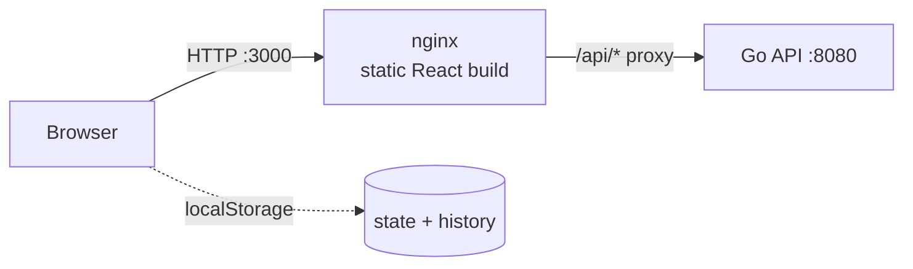
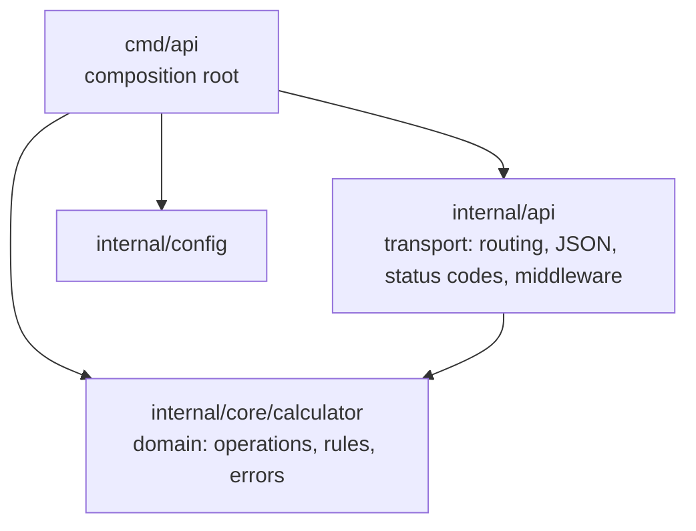
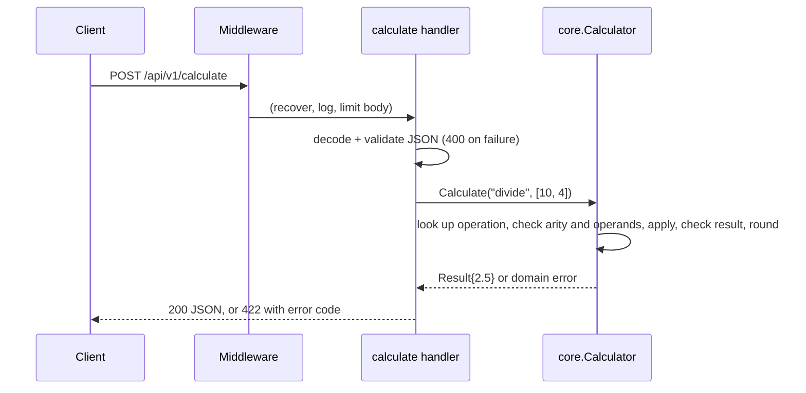
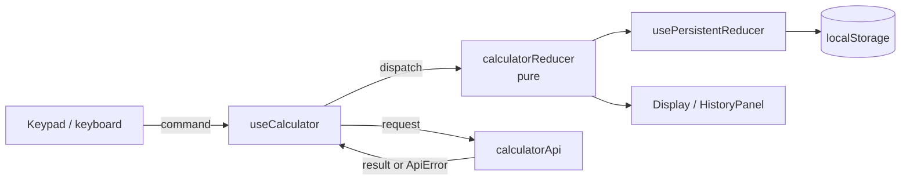

# Architecture

Status: accepted, implemented · Related: [functional spec](functional.md), [ADRs](../adr/)

## 1. System overview



Two deployable units. nginx serves the built React app and forwards `/api/*` to the Go
service, so the browser only ever talks to one origin. In development the Vite dev server
plays the same proxy role. The Go service is stateless; all user state lives in the browser
([ADR 0006](../adr/0006-client-side-state-and-persistence.md)).

## 2. Backend

### 2.1 Layers



**Dependency rule:** arrows point inwards. `core` imports only the standard library (`math`,
`errors`, `strconv`). It knows nothing about HTTP or JSON. `api` depends on `core` through a
small interface that `api` declares itself (Go's "accept interfaces" idiom), which also lets
handler tests use a fake. `cmd/api/main.go` is the only place that wires concrete types
together.

There is no infrastructure layer because there is nothing external to adapt: no database, no
third-party service. If server-side history were added later, `core` would declare a
`HistoryRepository` port and a new `internal/storage` package would implement it, without
changes to the existing layers ([ADR 0002](../adr/0002-layered-backend.md)).

### 2.2 Packages

| Package | Responsibility |
|---------|----------------|
| `internal/core/calculator` | `Operation` value objects and their registry, the `Calculator` domain service, sentinel domain errors, result rounding |
| `internal/api` | `http.Handler` construction, request decoding and validation, mapping domain errors to HTTP status and error codes, middleware |
| `internal/config` | Reading configuration from environment variables with defaults |
| `cmd/api` | Process entry point: config, logger, server timeouts, graceful shutdown |

### 2.3 Request flow



### 2.4 Error model

Domain errors are sentinel values (`calculator.ErrDivisionByZero`, ...). The API layer maps
them with `errors.Is` to a status and a stable machine-readable code. The client relies on the
code, never on the message text.

| Source | Status | Code |
|--------|:------:|------|
| Malformed or invalid request body | 400 | `invalid_request` |
| Body over 1 MB | 413 | `payload_too_large` |
| Any domain error | 422 | specific code, see [functional spec §2](functional.md#2-operations-backend) |
| Recovered panic | 500 | `internal_error` |

### 2.5 Configuration

| Variable | Default | Meaning |
|----------|---------|---------|
| `PORT` | `8080` | Listening port |
| `ALLOWED_ORIGINS` | empty | Comma-separated CORS origins. Empty disables CORS, which is the normal setup behind the proxy |
| `LOG_LEVEL` | `info` | `debug`, `info`, `warn` or `error` |

## 3. Frontend

### 3.1 Modules

```
src/
  api/                       HTTP client and typed calculator API (the only code that calls fetch)
  features/calculator/
    state/                   pure reducer, types, operation rules (percent base, labels), persistence schema
    hooks/                   useCalculator (side effects), useKeyboard
    components/              Calculator, Display, Keypad (+ key and keyboard map), HistoryPanel
    errorMessages.ts         error code → user-facing message
  shared/
    components/              Button, Panel (presentational, reusable)
    hooks/                   usePersistentReducer
    lib/                     storage, number formatting, class names
  styles/                    design tokens (CSS custom properties), global styles
```

The structure is feature-based: everything about the calculator lives in one folder, and only
code that is genuinely generic goes to `shared/`.

### 3.2 State and side effects



- `calculatorReducer` is a pure function `(state, action) → state`. It handles input editing
  directly and turns arithmetic intents into a `pendingRequest` in state. It has no I/O, so it
  is unit-tested exhaustively.
- `useCalculator` watches for a pending request, calls the API with an `AbortController`, then
  dispatches `requestSucceeded` or `requestFailed`. The API object is injected, so tests pass a
  fake.
- `usePersistentReducer` wraps `useReducer`: it hydrates from localStorage under a versioned key
  (`sezzle-calculator:v1`), validates the stored shape, and writes back on change. Transient
  fields (loading status, in-flight request) are not persisted.
- Components are presentational and receive data and callbacks through props. The tree is
  shallow, so React Context is not needed.
- The keypad is data-driven: `keys.ts` lists every key (label, accessible name, style, action)
  and the keyboard map points at the same key ids, so a click and a key press run the same code.

### 3.3 Styling

CSS Modules scope styles per component. Design tokens (colours, spacing, radii, font sizes)
are CSS custom properties in `styles/tokens.css`, so the look can be adjusted in one place.
Layout is mobile-first with one breakpoint at 768 px.

## 4. Testing strategy

| Layer | Tool | Focus |
|-------|------|-------|
| Go core | `testing`, table-driven | Every operation, every edge case and error, rounding |
| Go api | `net/http/httptest` | Status codes, error codes, JSON shape, middleware |
| FE reducer and operation rules | Vitest | Every transition in functional spec §3, driven by key sequences such as `'2+3*4='` |
| FE hooks | Vitest + Testing Library | Request lifecycle, abort, persistence and hydration |
| FE components | Vitest + Testing Library + user-event | Rendering, clicks, keyboard, accessibility names |
| FE API client | Vitest with mocked `fetch` | Success, API error, network error |

Coverage reports: `go test -coverprofile` for the backend, `@vitest/coverage-v8` for the
frontend. Summary in [docs/coverage.md](../coverage.md).
